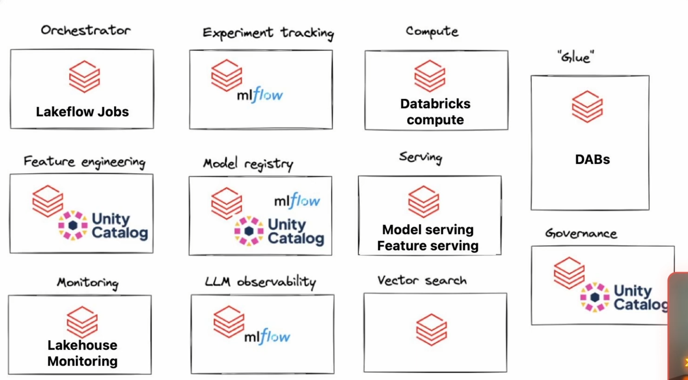

# MLOps Principles and Tools

Welcome to the first section! Here, we will cover the core principles of machine learning engineering. 

- **MLOps:** A set of practices that combines machine learning, software engineering (DevOps), and data engineering to automate, deploy, and manage machine learning models in production.

### Core Principles

- Traceability
- Reproducibility
- Code Quality
- Monitoring
- Documentation
- A/B Testing and Experimentation
- Feature Stores
- Explainability

### MLOps Tooling

These tools can be categorized based on their functionality:

- **Version Control:** Git, GitLab, Bitbucket, AWS CodeCommit
- **CI/CD:** Jenkins, Azure DevOps, GitHub Actions, etc.
- **Orchestration:** Airflow, Argo Workflows, Databricks Workflows
- **Model Registry:** MLflow, Amazon SageMaker
- **Compute:** Databricks Compute, Kubernetes, Azure, Amazon SageMaker
- **Serving:** Databricks, Kubernetes, Azure, Amazon SageMaker
- **Monitoring:** There are many tools available, but they are generally chosen based on the project's specific needs.
- **Container Registry:** Docker Hub
- **Feature Store:** Databricks, Hopsworks, Feast

### DevOps != MLOps

DevOps automates and streamlines traditional software development, while MLOps extends these principles to manage the unique lifecycle of machine learning (ML) models.

In an ideal scenario, software developers should be able to deploy their own software, and machine learning engineers should be able to deploy their own machine learning models. However, this rarely happens seamlessly. This gap is exactly why the MLOps team exists.

### MLOps with Databricks

Fortunately, Databricks provides a complete suite of tools necessary for MLOps.

