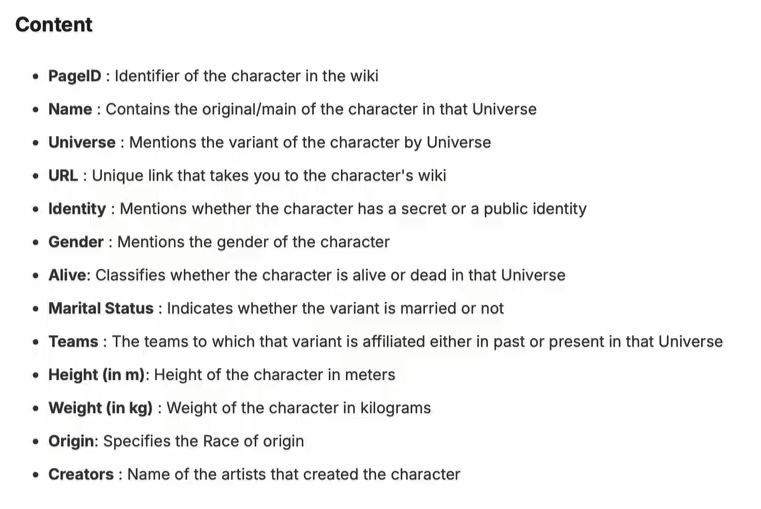

# Databricks Enviroment

We'll be using databricks Community edition, which has the free neccesary content that we need.

We are using the repo marvel-characters as our main source code. [repo](https://github.com/marvelousmlops/marvel-characters)

we could see in the file [project_config_marvel.yml](../marvel-characters/project_config_marvel.yml) the different configuration properties of the project.

Using the databricks interface we created the following:

- Catalogs
    - mlops_dev
    - mlops_prd
    - mlops_acc

- schemas
    - mlops_dev/marvel_characters
    - mlops_pdr/marvel_characters

Now to use databricks in the terminal, we need to install the Databricks CLI tool. You can follow step by step in the [databricks CLI documentation](https://docs.databricks.com/aws/en/dev-tools/cli/tutorial?language=Linux%2C%C2%A0macOS)

We updated the databricks target host in [datbricks.yml](../marvel-characters/databricks.yml) with the actual host in the Databrick interface.

During our developing process we'll use the databrick vs code extension. You can find this extention to install at the extensions section. It use a project and the databrick cli tool to communicate with the workspace.

In the [pyproject.toml](../marvel-characters/pyproject.toml) you can find the python requirements of the project. run `uv sync` to downloas all the needed packages.

In order to use the code directly in databricks, we can link a git folder using the UI.

Now after we add the git folder to our workspace, we can go ahead in and fill out the enviroment variables. The unique change you need to do here is to change enviroment version to 3, which is the most recient version.

# Project More in detaild

The data is from a kaggle repository, it is about Marvel Characters.

Last thing done: minute 21:28, I have ran the first cell of lecture2.marvel_data_processing.py notebook in the vs code enviroment.
