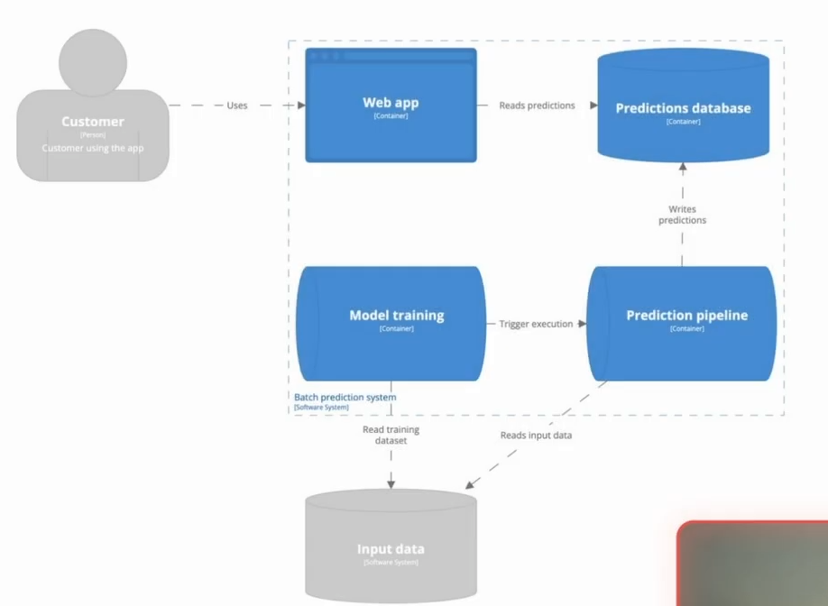
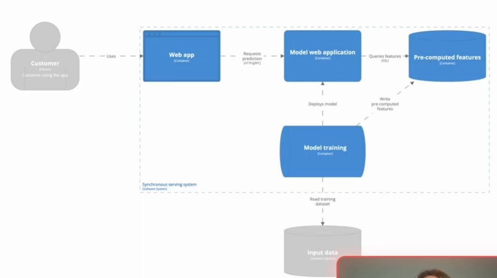
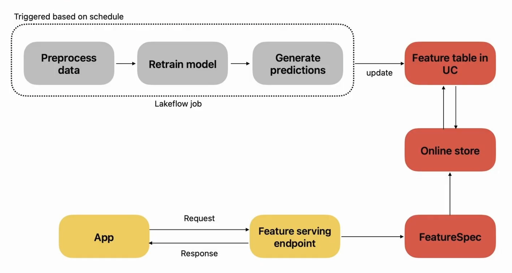
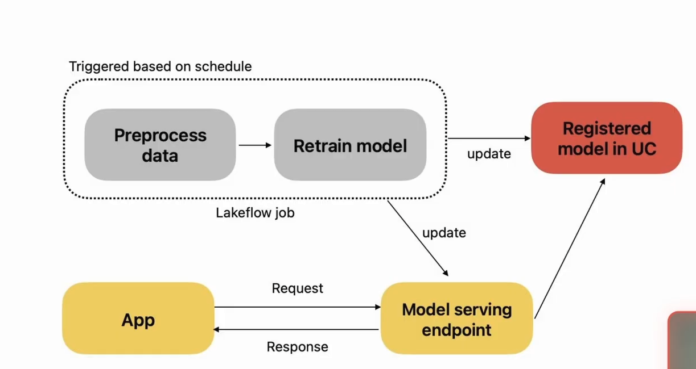
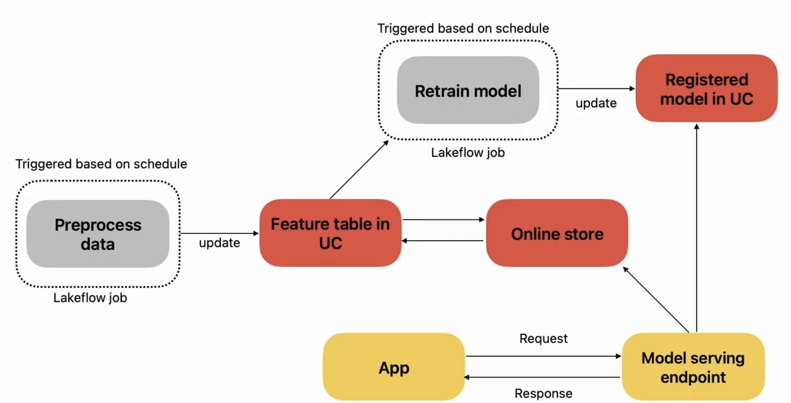

# Section 5: Model serving architectures

In this section we'll cover little bit about the principal architectures to serving models.

### Serving: Typical ML Architectures

**Batch serving:**

- All predictins are precomputed and stored in a database.

- ML endpoints is reading predictions from the database on request.

Typical use case: recommender system.

**Real-time model serving**

- ML endpoints is computing predictions at the request

Typical use case; fraud detection, recommender systems.

### Architecture in Databricks

**Feature Serving**

**Model Serving**

**Model Serving with feature lookup**

### Model Serving vs Feature Serving

|   prerequesites    |   Architecture    | 
|--------------------|-------------------|
| You have a model artifact and need predictions at the moment of the request | Use model serving | 
| You have a model artifact, and need predictions to be cpomputed and some features to be accessed at the moment of the request | Use model serving with feature lookup |
| Your prediction are pre-computered and need to be accessed at the moment of request | feature serving | 
|You need to compute a suimple function that doesn't requirea moel artifcat at the momento of request | Use feature serving =