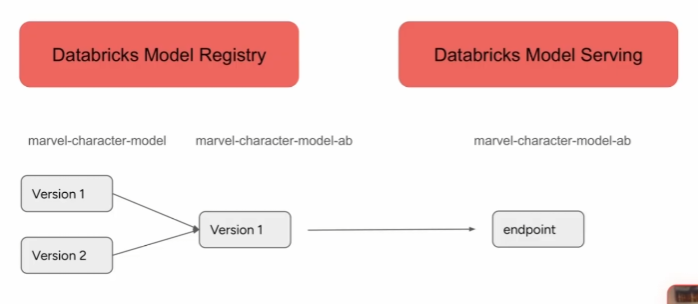

# Section 6 part 2 - Workflow Orquestration

### A/B Test vs Traffic Split

- Trafic split is not AB testing
- In case of AB testing, the same version of the model must be served to a customer during the whole experiment.
- Traffic split cannot guarantee that simple split based on the hash function works better!

**A/B Test Design**
