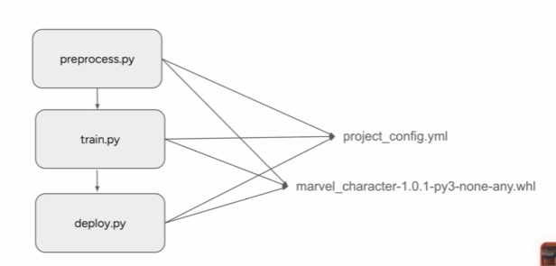
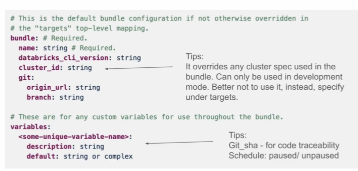
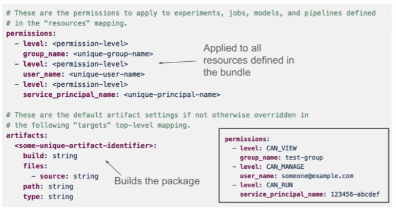
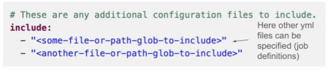
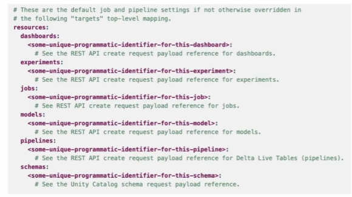
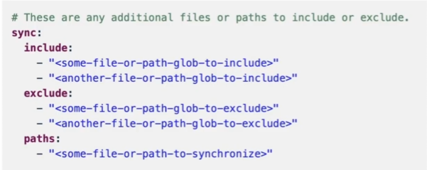
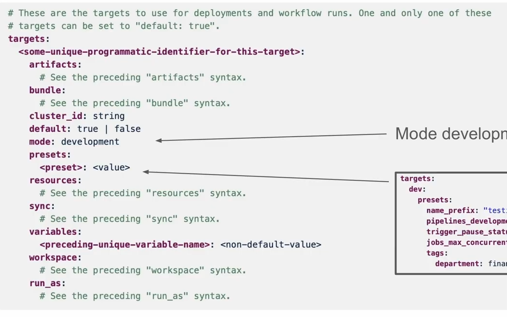

# Section 7: Databricks Assets Bundles

There are a multiple ways to deploy a Databricks job with all its dependencies

- Terraform
- Databricks APIs
- Databricks assets bundles (DAB)

Asset bundles is the recommended approach (uses terraform on the background)

**Databricks Assets Bundles (DAB)**

- Declarative configuration for Databricks resources (jobs, notebooks, models)

- Code + config in one place: enables reproducibility and CI/CD

- Defined using YAML files, deployed via CLI or CI pipelines

- Supports multiple enviroments (dev, staging, prod)

**Databricks Workflows**

- Workflows engine for building and scheduling jobs

- Supports notebooks, python scripts, JARs, SQL tasks, and dbt

- Enables task dependencies, retries, alerts and parameter passing

- Integrates with DABs for production-grade pipelines

**Example workflow**



**DAB components**













You can know more in [the databricks documentation](https://docs.databricks.com/aws/en/dev-tools/bundles/settings)


**Importants commands that we'll use**

```bash
#validates all definitions
databricks bundle validate

#deply the bundle
databricks bundle deploy

#runs the job
databricks bundle run


#destroy all resources specified in the bundle
databricks bundle destroy
```

