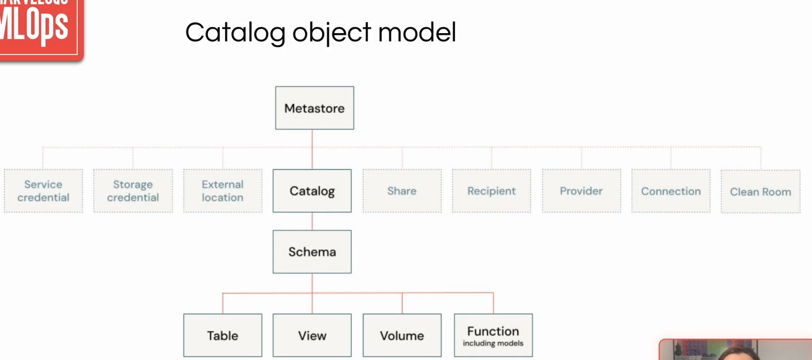

# Section 8 - CI/CD and deployment strategies

This lecture we'll cover 

- Catalogs and workspaces
- Git branching strategy
- CI/CD

### Access And Deployment Model

- All workspaces have read access to data in the production catalog
- Corresponding workspaces can read from and write to schemas in corresponding catalogs (dev -> dev, acc -> acc, prd -> prd)
- Users only have direct access to the development workspace
- Deployment in acc/prd can only be done via CD pipelines via service principals/managed identities.

### Who can see what, and where

**Workspace Securables**
- notebook, dashboards, clusters, jobs, endpoints
- Access controlled via ACLs (Access Control Lists)
- Users can manage their own objects
- Workspace admins can manage all objects in the workspace

**Unity Catalog Securables**
- Catalogs, schemas, tables, models, other assets
- Access controlled via privileges at the metastore level
- Metastore admins can manage metadata and permissions
- Ownership transfers are audit-logged

**Access Model and Binding**

- OPEN: Securable is visible across all workspaces
- ISOLATED: Access restricted to specific workspaces
- Use workspace binding to separate ML projecs (e.g Hotel Pricing vs Demand Forecasting)

Continue 2:15